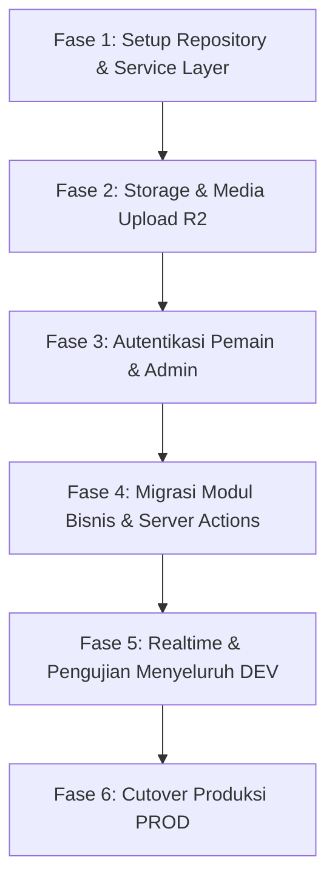

# Dokumen Arsitektur & Penyelesaian Migrasi: Supabase ke MongoDB
**Project:** Basecamp Padel Website  
**Status:** Selesai Dieksekusi & Terverifikasi (DEV Ready, PROD Ready)  
**Tanggal:** 21 Oktober 2026  

---

## 📌 Ringkasan Eksekutif (Executive Summary)

Migrasi database (data mentah) dari Supabase PostgreSQL ke MongoDB Atlas untuk environment **DEV** telah berhasil diselesaikan dengan 100% data (345 dokumen di 33 koleksi). 

Namun, Supabase dalam codebase ini tidak hanya berfungsi sebagai PostgreSQL database biasa, melainkan mencakup:
1. **Supabase Auth** (Google OAuth pemain, login email/password admin & coach, session cookies, dan JWT).
2. **Supabase Storage** (upload media di fitur Kelas Padel).
3. **Supabase Realtime** (`postgres_changes` untuk live match scoring & overlay OBS siaran).
4. **PostgreSQL RLS (Row Level Security)** & Security Definer functions (penyambungan akun pemain & validasi hak akses).
5. **Supabase Client Query Builder** (`.from("table").select(...)`) yang digunakan di ~50 file kode.

Dokumen ini memetakan seluruh perubahan arsitektur, daftar file terdampak, opsi solusi teknis, dan tahapan eksekusi yang terstruktur agar sistem tetap stabil tanpa downtime.

---

## 1. Perubahan Autentikasi & Manajemen Sesi (Authentication)

### Kondisi Saat Ini (Supabase Auth):
- **Login Pemain**: Menggunakan Google OAuth melalui `createBrowserClient().auth.signInWithOAuth({ provider: "google" })`.
- **Login Admin/Coach**: Menggunakan Email & Password melalui `auth.signInWithPassword` atau magic link `auth.signInWithOtp`.
- **Session Handling**: Dilakukan oleh `@supabase/ssr` melalui cookies HTTP-Only yang dicek dan di-refresh di Next.js middleware ([src/proxy.ts](file:///home/jamaludinak/Projects/Diraya/basecamppadel-website/src/proxy.ts)) dan landing callback ([src/app/auth/callback/route.ts](file:///home/jamaludinak/Projects/Diraya/basecamppadel-website/src/app/auth/callback/route.ts)).
- **Role & Hak Akses**: Dicek via pencocokan `auth.users.id` dengan tabel `admin_users` (`role: "admin" | "coach"`).

### Opsi Solusi untuk MongoDB:

| Pendekatan | Kelebihan | Kekurangan | Rekomendasi |
| :--- | :--- | :--- | :---: |
| **Opsi A: Auth.js (NextAuth v5) + MongoDB Adapter** | Standar industri Next.js, native support Google OAuth & Credentials (email/pass), session cookie aman, terintegrasi langsung dengan MongoDB. | Perlu konfigurasi handler Auth.js dan mapping schema user. | ⭐ **Sangat Direkomendasikan** |
| **Opsi B: Custom JWT Session (jose / iron-session)** | Kontrol penuh tanpa library pihak ketiga, ringan. | Harus menulis kode sign-in Google OAuth flow, enkripsi password (bcrypt), dan token refresh secara manual. | Alternatif jika ingin lightweight |
| **Opsi C: Hybrid (Supabase Auth + MongoDB Data)** | Login tidak perlu diubah sama sekali, transisi paling cepat. | Masih ketergantungan pada akun Supabase untuk auth. | Transisi sementara |

### Perubahan Kode Terkait Auth:
1. **Middleware / Session Checker**:
   - Ganti [src/lib/supabase/proxy.ts](file:///home/jamaludinak/Projects/Diraya/basecamppadel-website/src/lib/supabase/proxy.ts) dan [src/proxy.ts](file:///home/jamaludinak/Projects/Diraya/basecamppadel-website/src/proxy.ts) dengan session verification berbasis cookie JWT / Auth.js.
2. **Halaman Login Pemain**:
   - [src/components/account/GoogleButton.tsx](file:///home/jamaludinak/Projects/Diraya/basecamppadel-website/src/components/account/GoogleButton.tsx): ubah pemicu login ke endpoint Google Auth baru (misal `/api/auth/signin/google`).
3. **Halaman Login Admin**:
   - [src/app/admin/login/LoginForm.tsx](file:///home/jamaludinak/Projects/Diraya/basecamppadel-website/src/app/admin/login/LoginForm.tsx): verifikasi email & password (bcrypt hash) terhadap koleksi `admin_users` atau `auth_users` di MongoDB.
4. **Helper Auth**:
   - [src/lib/auth.ts](file:///home/jamaludinak/Projects/Diraya/basecamppadel-website/src/lib/auth.ts): perbarui fungsi `getAdminUser()`, `requireAdmin()`, dan `requireAdminOrCoach()` agar membaca session cookie & query ke koleksi MongoDB.

---

## 2. Perubahan Data Access Layer (Query & CRUD)

Di Supabase, kode memanggil query builder berantai seperti:
```typescript
const { data, error } = await supabase
  .from("players")
  .select("*")
  .eq("active", true)
  .order("points", { ascending: false });
```

Di MongoDB, ini harus diganti menjadi native MongoDB Driver (atau repository helper):
```typescript
import { getDb } from "@/lib/mongodb";

const db = await getDb();
const players = await db.collection("players")
  .find({ active: true })
  .sort({ points: -1 })
  .toArray();
```

### Relasi Antar Tabel (Joins vs Lookups / Enriched Docs):
- Pada Supabase: relasi diambil menggunakan sintaks join Postgres seperti `.select("*, venue:venues(*)")` atau foreign table embeds.
- Pada MongoDB:
  - Gunakan helper utility sederhana untuk populate berdasarkan ID (misal query ID secara paralel menggunakan `$in: [...]`), atau
  - Menggunakan MongoDB Aggregation `$lookup`.
  - Pendekatan paralel lookup di service layer lebih cepat dan mudah di-maintain untuk Next.js App Router dibanding `$lookup` yang rumit.

### Penanganan Primary Key:
- PostgreSQL menggunakan `id` (UUID).
- Di MongoDB, migrasi yang kita buat telah menetapkan `_id = row.id` dan sekaligus menyimpan field `id = row.id`.
- Dengan demikian, query dapat menggunakan `{ _id: id }` atau `{ id: id }` tanpa perlu merombak format UUID yang sudah berelasi di seluruh aplikasi.

### Penanganan Stored Procedures / PostgreSQL Functions (`supabase.rpc`):
Di Supabase, terdapat beberapa fungsi database tersimpan (PL/pgSQL) dengan atribut `security definer` untuk membypass aturan RLS. Pada commit terbaru yang baru di-pull (PR #20), ditambahkan fungsi baru `coaching_set_session_status` di `0021_coach_session_status.sql`.

Berikut pemetaan seluruh `supabase.rpc` ke service TypeScript di MongoDB:

| Fungsi Supabase RPC | Lokasi Pemanggilan | Implementasi di MongoDB |
| :--- | :--- | :--- |
| `coaching_set_session_status` *(Baru di-pull)* | `src/app/admin/coaching/session-actions.ts` | `db.collection("coaching_sessions").updateOne({ _id: sessionId }, { $set: { status, updated_at: new Date() } })` |
| `account_save_profile` | `src/app/akun/actions.ts` | Upsert dokumen ke koleksi `profiles` & sinkronisasi nama ke koleksi `players`. |
| `account_choose_player` | `src/app/akun/actions.ts` | Update `player_id` atau `claim_player_id` pada koleksi `profiles`. |
| `account_delete` | `src/app/akun/actions.ts` | Delete dokumen dari `profiles` dan `auth_users`. |
| `account_name_candidates` | `src/app/akun/sambungkan/page.tsx` | Query pencocokan nama pemain via regex `$regex` di koleksi `players`. |
| `account_resolve_claim` | `src/app/admin/actions.ts` | Update persetujuan klaim pemain di koleksi `profiles`. |
| `account_set_default_photo` | `src/lib/accountPhoto.ts` | Update field `photo_url` di koleksi `profiles` & `players`. |
| `comp_set_result` | `src/app/admin/events/match-actions.ts` | Update skor pertandingan, pemenang, dan hitung poin pemain di koleksi `matches` & `players`. |
| `comp_finish_event` | `src/app/admin/events/match-actions.ts` | Update status event ke `finished` dan catat riwayat penghargaan. |
| `coaching_apply_level` | `src/app/admin/coaching/actions.ts` | Update field `level` pada dokumen pemain di koleksi `players`. |

> **Keuntungan di MongoDB:** Semua logika di atas tidak lagi memerlukan SQL Stored Procedure / PL/pgSQL yang rumit di level database, melainkan menjadi kode **TypeScript murni** yang mudah di-debug, diuji dengan unit test, dan aman karena dijalankan di server-side Next.js.

---

## 3. Fitur Realtime (Live Scoring & OBS Overlay)

### Kondisi Saat Ini:
- [src/lib/useLiveMatch.ts](file:///home/jamaludinak/Projects/Diraya/basecamppadel-website/src/lib/useLiveMatch.ts) dan [src/components/admin/event/EventRealtime.tsx](file:///home/jamaludinak/Projects/Diraya/basecamppadel-website/src/components/admin/event/EventRealtime.tsx) mendengarkan perubahan skor pertandingan secara instan via `supabase.channel().on("postgres_changes", ...)`.
- Ini digunakan untuk update skor di siaran langsung (OBS Browser Source / overlay) dan live match control.

### Solusi Pengganti untuk MongoDB:
1. **Server-Sent Events (SSE) / Polling Ringan (SWR / React Query)**:
   - Polling setiap 1–2 detik saat match berlangsung (`is_live = true`), atau route handler SSE `/api/live/stream?matchId=...`.
   - Sangat handal, ramah arsitektur serverless Next.js, dan tidak memerlukan server WebSocket khusus.
2. **Pusher / Ably (WebSockets as a Service)**:
   - Jika ingin tetap instant push event saat admin menekan tombol poin di `/admin/live`.
   - Saat Server Action skor dieksekusi, trigger event ke channel Pusher/Ably.

---

## 4. Pengalihan Storage (Supabase Storage ➔ Cloudflare R2)

### Kondisi Saat Ini:
- Sebagian besar aset foto pemain sudah dialihkan ke Cloudflare R2 (menggunakan `STORAGE_WORKER_URL` dan worker R2).
- Namun, **fitur upload media kelas** di [src/app/api/admin/kelas/upload/route.ts](file:///home/jamaludinak/Projects/Diraya/basecamppadel-website/src/app/api/admin/kelas/upload/route.ts) masih memakai `supabase.storage.from("classes").upload(...)`.

### Rencana Perubahan:
- Alihkan upload bucket `classes` tersebut ke Cloudflare R2 menggunakan S3 API Client (`@aws-sdk/client-s3`), karena kredensial R2 sudah tersedia lengkap di [.env](file:///home/jamaludinak/Projects/Diraya/basecamppadel-website/.env) (`R2_ACCESS_KEY_ID`, `R2_SECRET_ACCESS_KEY`, `R2_BUCKET`).
- Dengan demikian, ketergantungan pada Supabase Storage menjadi **0%**.

---

## 5. Daftar File yang Wajib Diubah

Berikut adalah daftar file yang perlu disesuaikan, dikelompokkan berdasarkan fungsinya (termasuk penambahan rute baru hasil git pull terakhir):

### A. Infrastruktur & Core Libs (Prioritas Utama)
1. [src/lib/supabase/client.ts](file:///home/jamaludinak/Projects/Diraya/basecamppadel-website/src/lib/supabase/client.ts) → Hapus / ganti dengan Client API.
2. [src/lib/supabase/server.ts](file:///home/jamaludinak/Projects/Diraya/basecamppadel-website/src/lib/supabase/server.ts) → Hapus / ganti dengan Mongo Server DB provider.
3. [src/lib/supabase/proxy.ts](file:///home/jamaludinak/Projects/Diraya/basecamppadel-website/src/lib/supabase/proxy.ts) → Diganti dengan middleware otentikasi baru.
4. [src/proxy.ts](file:///home/jamaludinak/Projects/Diraya/basecamppadel-website/src/proxy.ts) → Update middleware call.
5. [src/lib/auth.ts](file:///home/jamaludinak/Projects/Diraya/basecamppadel-website/src/lib/auth.ts) → Penyesuaian `getAdminUser()` dan guard hak akses.
6. [src/lib/server/action.ts](file:///home/jamaludinak/Projects/Diraya/basecamppadel-website/src/lib/server/action.ts) → Menyesuaikan error handling unique constraint (E11000 duplicate key Mongo).
7. [src/lib/database.types.ts](file:///home/jamaludinak/Projects/Diraya/basecamppadel-website/src/lib/database.types.ts) → Refactor tipe data schema Mongo.

### B. Business Logic & Query Modules
8. [src/lib/queries.ts](file:///home/jamaludinak/Projects/Diraya/basecamppadel-website/src/lib/queries.ts) → Query `players`, `sessions`, `venues`, `leaderboard`.
9. [src/lib/events.ts](file:///home/jamaludinak/Projects/Diraya/basecamppadel-website/src/lib/events.ts) → CRUD event turnamen, bracket match, tim.
10. [src/lib/compData.ts](file:///home/jamaludinak/Projects/Diraya/basecamppadel-website/src/lib/compData.ts) → Perhitungan skor, log skor match, live state.
11. [src/lib/coaching-db.ts](file:///home/jamaludinak/Projects/Diraya/basecamppadel-website/src/lib/coaching-db.ts) → CRUD sesi coaching, penilaian rapor coach, skill padel.
12. [src/lib/profileData.ts](file:///home/jamaludinak/Projects/Diraya/basecamppadel-website/src/lib/profileData.ts) *(diupdate dari PR #20)* → `loadCoaching()` disesuaikan ke Mongo.
13. [src/lib/server/kelas.ts](file:///home/jamaludinak/Projects/Diraya/basecamppadel-website/src/lib/server/kelas.ts) → CRUD kelas, jadwal sesi, pendaftar, ulasan, komentar.
14. [src/lib/leagues.ts](file:///home/jamaludinak/Projects/Diraya/basecamppadel-website/src/lib/leagues.ts) → CRUD Liga Padel & klasemen volume.
15. [src/lib/account.ts](file:///home/jamaludinak/Projects/Diraya/basecamppadel-website/src/lib/account.ts) & [src/lib/accountPhoto.ts](file:///home/jamaludinak/Projects/Diraya/basecamppadel-website/src/lib/accountPhoto.ts) → Manajemen profil pemain, sinkronisasi foto Google & R2.
16. [src/lib/mabar.ts](file:///home/jamaludinak/Projects/Diraya/basecamppadel-website/src/lib/mabar.ts) → Pengaturan preset mabar dan sesi open play.

### C. Autentikasi & Routing
17. [src/app/auth/callback/route.ts](file:///home/jamaludinak/Projects/Diraya/basecamppadel-website/src/app/auth/callback/route.ts)
18. [src/app/auth/signout/route.ts](file:///home/jamaludinak/Projects/Diraya/basecamppadel-website/src/app/auth/signout/route.ts)
19. [src/app/masuk/page.tsx](file:///home/jamaludinak/Projects/Diraya/basecamppadel-website/src/app/masuk/page.tsx)
20. [src/components/account/GoogleButton.tsx](file:///home/jamaludinak/Projects/Diraya/basecamppadel-website/src/components/account/GoogleButton.tsx)
21. [src/app/admin/login/LoginForm.tsx](file:///home/jamaludinak/Projects/Diraya/basecamppadel-website/src/app/admin/login/LoginForm.tsx)

### D. Server Actions & Routes Baru
22. [src/app/admin/actions.ts](file:///home/jamaludinak/Projects/Diraya/basecamppadel-website/src/app/admin/actions.ts) (Admin global actions)
23. [src/app/admin/events/actions.ts](file:///home/jamaludinak/Projects/Diraya/basecamppadel-website/src/app/admin/events/actions.ts)
24. [src/app/admin/events/match-actions.ts](file:///home/jamaludinak/Projects/Diraya/basecamppadel-website/src/app/admin/events/match-actions.ts)
25. [src/app/admin/events/live-actions.ts](file:///home/jamaludinak/Projects/Diraya/basecamppadel-website/src/app/admin/events/live-actions.ts)
26. [src/app/admin/events/mabar-actions.ts](file:///home/jamaludinak/Projects/Diraya/basecamppadel-website/src/app/admin/events/mabar-actions.ts)
27. [src/app/admin/coaching/actions.ts](file:///home/jamaludinak/Projects/Diraya/basecamppadel-website/src/app/admin/coaching/actions.ts)
28. [src/app/admin/coaching/session-actions.ts](file:///home/jamaludinak/Projects/Diraya/basecamppadel-website/src/app/admin/coaching/session-actions.ts) *(termasuk action baru `setCoachingSessionStatusAction`)*
29. [src/app/admin/coaching/rapor/[id]/route.ts](file:///home/jamaludinak/Projects/Diraya/basecamppadel-website/src/app/admin/coaching/rapor/[id]/route.ts) *(Route baru dari PR #20)*
30. [src/app/admin/coaching/skill-actions.ts](file:///home/jamaludinak/Projects/Diraya/basecamppadel-website/src/app/admin/coaching/skill-actions.ts)
31. [src/app/admin/kelas/actions.ts](file:///home/jamaludinak/Projects/Diraya/basecamppadel-website/src/app/admin/kelas/actions.ts)
32. [src/app/admin/liga/actions.ts](file:///home/jamaludinak/Projects/Diraya/basecamppadel-website/src/app/admin/liga/actions.ts)
33. [src/app/admin/generator/actions.ts](file:///home/jamaludinak/Projects/Diraya/basecamppadel-website/src/app/admin/generator/actions.ts)
34. [src/app/admin/point/actions.ts](file:///home/jamaludinak/Projects/Diraya/basecamppadel-website/src/app/admin/point/actions.ts)
35. [src/app/akun/actions.ts](file:///home/jamaludinak/Projects/Diraya/basecamppadel-website/src/app/akun/actions.ts)
36. [src/app/kelas/actions.ts](file:///home/jamaludinak/Projects/Diraya/basecamppadel-website/src/app/kelas/actions.ts)

### E. Halaman & UI Components (Pages)
35. `src/app/admin/events/[id]/page.tsx` & `page.tsx`
36. `src/app/admin/coaching/page.tsx`, `sessions/[id]/page.tsx`, `new/page.tsx`
37. `src/app/admin/kelas/[id]/page.tsx`, `edit/page.tsx`
38. `src/app/admin/liga/[id]/page.tsx`, `page.tsx`
39. `src/app/admin/live/page.tsx` & `quick/page.tsx`
40. `src/app/admin/players/page.tsx`
41. `src/app/admin/sessions/page.tsx`
42. `src/app/admin/venues/page.tsx`
43. `src/app/overlay/page.tsx`
44. `src/app/leaderboard/[playerId]/page.tsx`
45. `src/components/admin/live/useMatchControl.ts`
46. `src/components/admin/event/EventRealtime.tsx`
47. `src/lib/useLiveMatch.ts`
48. `src/app/api/admin/kelas/upload/route.ts` (Storage upload)

### F. Scripts & Tooling
49. [scripts/db.mjs](file:///home/jamaludinak/Projects/Diraya/basecamppadel-website/scripts/db.mjs) → Ganti atau lengkapi dengan CLI MongoDB (seperti seed & create admin).
50. [scripts/seed-classes.mjs](file:///home/jamaludinak/Projects/Diraya/basecamppadel-website/scripts/seed-classes.mjs) & [scripts/seed-coaching.mjs](file:///home/jamaludinak/Projects/Diraya/basecamppadel-website/scripts/seed-coaching.mjs).

---

## 6. Tahapan Pelaksanaan Migrasi (Execution Roadmap)

Untuk menjaga risiko sekecil mungkin, pengerjaan dibagi menjadi **5 Fase bertahap**:



### Fase 1: Setup Repository & Service Layer (Pondasi)
1. Membuat modul Mongo collection query wrappers di `src/lib/db/*` (Player, Event, Match, Class, Coach, League).
2. Memastikan helper CRUD Mongo menyediakan tipe TypeScript yang kuat menggantikan Supabase types.

### Fase 2: Pengalihan Storage ke R2
1. Update [src/app/api/admin/kelas/upload/route.ts](file:///home/jamaludinak/Projects/Diraya/basecamppadel-website/src/app/api/admin/kelas/upload/route.ts) agar menyimpan langsung ke Cloudflare R2 bucket.
2. Memastikan seluruh media foto/video tidak lagi memanggil Supabase Storage.

### Fase 3: Autentikasi & Session Middleware
1. Menentukan mekanisme auth (misal Auth.js v5 atau custom JWT).
2. Mengganti flow Google login di `/masuk` dan email/password di `/admin/login`.
3. Mengganti pemeriksaan session di middleware `src/proxy.ts` dan guard `src/lib/auth.ts`.
4. Testing flow login pemain baru, klaim profil, dan hak akses admin/coach.

### Fase 4: Migrasi Modul Bisnis & Server Actions
Migrasi dilakukan secara modular dan teruji satu per satu:
1. **Modul 1**: Pemain, Leaderboard & Venue (`queries.ts`, `players/page.tsx`, `venues/page.tsx`).
2. **Modul 2**: Event & Turnamen Padel (`events.ts`, `compData.ts`, `match-actions.ts`).
3. **Modul 3**: Coaching & Rapor (`coaching-db.ts`, `session-actions.ts`).
4. **Modul 4**: Kelas Padel (`server/kelas.ts`, `kelas/actions.ts`).
5. **Modul 5**: Liga Padel (`leagues.ts`, `liga/actions.ts`).

### Fase 5: Realtime Live Scoring & OBS
1. Menyesuaikan `useLiveMatch.ts` dan `EventRealtime.tsx` menggunakan polling SSE/SWR yang efisien untuk overlay OBS.
2. Pengujian end-to-end pada siaran OBS live control match.

### Fase 6: Final Cutover ke PROD
1. Setelah seluruh fungsi di DEV diverifikasi 100% lulus QA.
2. Menjalankan migrasi data PROD: `npm run db:mongo:migrate:prod`.
3. Menghapus package `@supabase/supabase-js` dan `@supabase/ssr` dari dependencies.
4. Deployment ke production.

---

## 7. Rencana Mitigasi Risiko & Rollback

1. **Database DEV & PROD Terpisah**:
   - Skrip migrasi telah memblokir data PROD secara default (`--confirm-prod` wajib disertakan).
   - Seluruh proses adaptasi kode diuji coba di database `DEV` tanpa mengganggu database Supabase `PROD` yang saat ini aktif melayani user.
2. **Backward Compatibility**:
   - Struktur field dokumen di MongoDB dipertahankan sama persis dengan kolom PostgreSQL (termasuk UUID string).
   - Jika sewaktu-waktu perlu melakukan rollback ke Supabase pada fase transisi, struktur data tetap 100% identik dan mudah dikembalikan.
