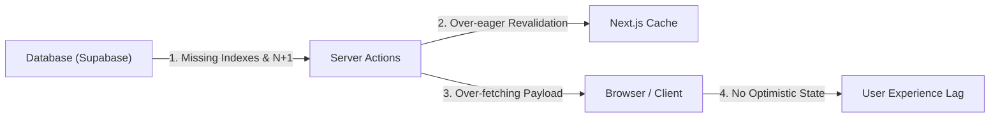

# 🚀 Panduan & Rencana Optimasi Performa CRUD Admin

Dokumen ini merangkum audit performa, titik bottleneck pada dashboard Admin Basecamp Padel (`/admin/*`), dan panduan teknis implementasi optimasi agar siap dieksekusi sewaktu-waktu setelah pengembangan fitur selesai.

---

## 1. Ringkasan Diagnosa & Bottleneck

Dashboard admin Basecamp Padel mengandalkan Next.js 15 Server Actions dan Supabase PostgreSQL. Berdasarkan analisis kode, terdapat 5 area bottleneck utama yang mempengaruhi performa:



1. **Database Indexing**: Foreign key (`event_id`, `court_id`, `session_id`, `player_id`) dan kolom status query belum memiliki index eksplisit di Supabase migrations. Ini memicu *Sequential Scan* penuh pada tabel relasi.
2. **N+1 Loops di Server Actions**: Loop asynchronous (`for ... of await`) pada pembuatan ronde mabar/generator dan penyesuaian skor.
3. **Over-fetching di Halaman Pemain (`/admin/players`)**: Mengambil seluruh baris tabel pemain dan profil sekaligus ke memori browser, filter & sort dijalankan di client-side.
4. **Over-eager Cache Invalidation (`revalidatePath`)**: Invalidation berlebihan (`revalidatePublic()`) yang menghapus cache public pages meskipun perubahan hanya bersifat internal admin.
5. **Kurangnya Optimistic UI**: Tombol scoring dan status update menunggu respon network penuh sebelum UI bereaksi.

---

## 2. Rencana Implementasi Bertahap (Roadmap)

### Fase 1: Database Indexing (Prioritas Tertinggi / Quick Win)
> **Target**: Mengurangi waktu eksekusi query relasi Supabase dari ratusan milidetik menjadi <10ms.

Buat migration file baru (contoh: `supabase/migrations/0020_performance_indexes.sql`):

```sql
-- 1. Matches & Events (Live Scoring, Match Queue, Standings)
CREATE INDEX IF NOT EXISTS idx_matches_event_id ON matches(event_id);
CREATE INDEX IF NOT EXISTS idx_matches_court_id ON matches(court_id);
CREATE INDEX IF NOT EXISTS idx_matches_status ON matches(status);
CREATE INDEX IF NOT EXISTS idx_matches_event_status ON matches(event_id, status);
CREATE INDEX IF NOT EXISTS idx_matches_starts_at ON matches(starts_at);

-- 2. Kompetisi Teams & Players
CREATE INDEX IF NOT EXISTS idx_comp_teams_event_id ON comp_teams(event_id);
CREATE INDEX IF NOT EXISTS idx_comp_team_players_event_id ON comp_team_players(event_id);
CREATE INDEX IF NOT EXISTS idx_comp_team_players_team_id ON comp_team_players(team_id);
CREATE INDEX IF NOT EXISTS idx_comp_team_players_player_id ON comp_team_players(player_id);

-- 3. Mabar & Generator
CREATE INDEX IF NOT EXISTS idx_gen_participants_event_id ON gen_participants(event_id);
CREATE INDEX IF NOT EXISTS idx_gen_rounds_event_id ON gen_rounds(event_id);
CREATE INDEX IF NOT EXISTS idx_gen_matches_round_id ON gen_matches(round_id);

-- 4. Coaching Sessions & Assessments
CREATE INDEX IF NOT EXISTS idx_coaching_assessments_session_id ON coaching_assessments(session_id);
CREATE INDEX IF NOT EXISTS idx_coaching_assessments_player_id ON coaching_assessments(player_id);
CREATE INDEX IF NOT EXISTS idx_coaching_session_players_session_id ON coaching_session_players(session_id);

-- 5. Profiles & Players
CREATE INDEX IF NOT EXISTS idx_profiles_player_id ON profiles(player_id);
CREATE INDEX IF NOT EXISTS idx_profiles_claim_player_id ON profiles(claim_player_id);
CREATE INDEX IF NOT EXISTS idx_players_active_points ON players(active, points DESC);
```

---

### Fase 2: Batching Query & Eliminasi N+1 Loops

#### 1. Mabar Actions (`src/app/admin/events/mabar-actions.ts`)
**Masalah**: Update peserta istirahat dilakukan berurutan di dalam loop:
```typescript
// SEBELUM:
for (const id of resting) {
  const p = byId.get(id);
  if (p) await supabase.from("gen_participants").update({ sits_out_count: p.sits_out_count + 1 }).eq("id", id);
}
```

**Solusi**: Paralelisasi dengan `Promise.all`:
```typescript
// SESUDAH:
const updates = resting
  .map((id) => byId.get(id))
  .filter((p): p is NonNullable<typeof p> => Boolean(p))
  .map((p) => supabase.from("gen_participants").update({ sits_out_count: p.sits_out_count + 1 }).eq("id", p.id));
await Promise.all(updates);
```

#### 2. Generator Match Actions (`src/app/admin/generator/actions.ts`)
**Masalah**: Penyesuaian `total_points` dilakukan berurutan:
```typescript
// SEBELUM:
for (const r of rows ?? []) {
  await supabase.from("gen_participants").update({ total_points: r.total_points + delta }).eq("id", r.id);
}
```

**Solusi**:
```typescript
// SESUDAH:
await Promise.all(
  (rows ?? []).map((r) =>
    supabase.from("gen_participants").update({ total_points: r.total_points + delta }).eq("id", r.id)
  )
);
```

---

### Fase 3: Server-side Search & Pagination (`/admin/players`)

**Lokasi File**:
- `src/app/admin/players/page.tsx`
- `src/components/admin/players/PlayersList.tsx`

**Langkah Perubahan**:
1. Baca URL search parameters di server component:
   ```typescript
   export default async function PlayersAdmin({
     searchParams,
   }: {
     searchParams: Promise<{ q?: string; level?: string; gender?: string; page?: string }>;
   })
   ```
2. Buat query Supabase dengan `.ilike()`, `.eq()`, dan `.range(start, end)`:
   ```typescript
   const PAGE_SIZE = 50;
   const from = (page - 1) * PAGE_SIZE;
   const to = from + PAGE_SIZE - 1;

   let q = supabase.from("players").select("*", { count: "exact" });
   if (searchTerm) q = q.ilike("name", `%${searchTerm}%`);
   if (gender) q = q.eq("gender", gender);
   if (level) q = q.eq("level", level);
   const { data: players, count } = await q.order("points", { ascending: false }).range(from, to);
   ```
3. Hanya kirim data halaman aktif ke client component.

---

### Fase 4: Presisi Revalidasi Cache (`revalidatePath`)

**Lokasi File**: `src/app/admin/actions.ts`

**Langkah Perubahan**:
Hindari memanggil `revalidatePublic()` di seluruh mutasi pemain/sesi:
- **Edit detail internal pemain (nama/wa/foto)**: Cukup revalidate `/admin/players` dan `/admin/players?edit=[id]`.
- **Hanya panggil revalidasi public (`/leaderboard`)**: Ketika terjadi perubahan pada poin, match selesai, atau approved claim profil pemain.

---

### Fase 5: Optimistic UI pada Live Score Admin

**Lokasi File**:
- `src/components/admin/live/ScoreInputs.tsx`
- `src/components/admin/event/mabar/CourtScoreCard.tsx`

**Langkah Perubahan**:
1. Gunakan hook React 19 `useOptimistic`:
   ```typescript
   const [optimisticScore, setOptimisticScore] = useOptimistic(
     actualScore,
     (state, delta: number) => Math.max(0, state + delta)
   );
   ```
2. Tombol `+` / `-` langsung mengupdate `optimisticScore` secara instan di UI, sementara pemanggilan action dijalankan di background via `startTransition`.

---

## 3. Checklist Eksekusi Nanti

Saat siap mengoptimasi:
- [ ] Buat file migrasi `supabase/migrations/0020_performance_indexes.sql` dan apply ke Supabase.
- [ ] Refactor `for ... of await` di `mabar-actions.ts` dan `generator/actions.ts` ke `Promise.all`.
- [ ] Cek profiling log latensi sebelum dan sesudah batching.
- [ ] Implementasikan pagination & search di `/admin/players`.
- [ ] Rapikan cakupan `revalidatePath` di `src/app/admin/actions.ts`.
- [ ] Uji responsivitas dashboard admin di perangkat mobile dan desktop.
