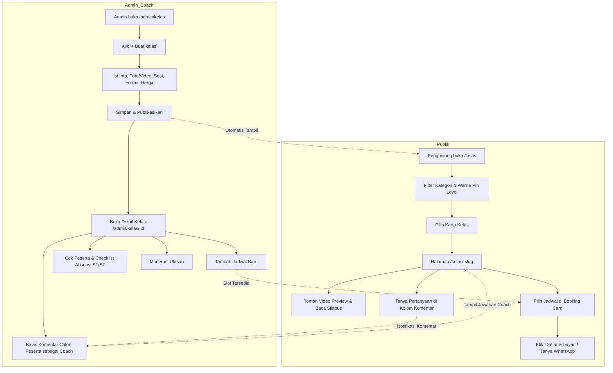

# Rencana & Spesifikasi Implementasi Fitur Kelas (Basecamp Padel)

Dokumentasi ini merangkum analisis rancangan UI (`docs/UI/kelas/`), arsitektur sistem Basecamp Padel, skema database Supabase, logika bisnis, serta panduan implementasi langkah demi langkah (step-by-step).

---

## 1. Ringkasan Eksekutif & Tujuan Fitur

Fitur **Kelas (Padel Academy / Coaching Clinic)** dirancang untuk memfasilitasi kurikulum pelatihan padel bertahap di Basecamp Padel, mulai dari pemain pemula (*Firstimer*) hingga tingkat lanjut (*Turnamen & Penyerang*).

### Masalah yang Diselesaikan:
1. **Katalog Terstruktur**: Menggantikan pendaftaran manual via chat dengan katalog kelas interaktif yang menampilkan silabus, video/foto preview, pin level yang cocok, dan profil coach.
2. **Manajemen Jadwal & Kapasitas**: Membatasi kuota peserta (misal 4 orang per coach) secara transparan per jadwal dan mencegah overbooking.
3. **Penyelarasan Sistem Level Pin**: Menghubungkan kurikulum dengan sistem pin warna pemain (*Putih, Kuning, Biru, Merah, Hitam*) yang sudah ada di sistem penilaian coaching (`docs/level-system.md`).
4. **Interaksi & Reputasi**: Menyediakan kolom tanya jawab (komentar) publik dengan balasan resmi coach serta ulasan berbintang (*verified reviews*) dari peserta yang benar-benar mengikuti kelas.
5. **Kemudahan Operasional Admin & Coach**: Memudahkan absensi per sesi (*Hadir S1, Hadir S2*), pengingat WhatsApp otomatis, dan pemantauan pembayaran (*Lunas / Menunggu Bayar*).

---

## 2. Analisis Rancangan UI (Berdasarkan Mockup di `docs/UI/kelas`)

Dari inspeksi file mockup desktop dan mobile di `docs/UI/kelas/`, berikut rincian layar dan komponennya:

### 2.1 Halaman Publik

| Layar Mockup | Endpoint Usulan | Deskripsi & Komponen Utama |
|---|---|---|
| `Kelas.html` & `Kelas-Mobile.html` | `/kelas` | **Katalog Kelas Publik**<br>• Hero banner (*"Belajar bareng coach, step by step"* + stat 1.846 peserta).<br>• Filter bar: Cari kata kunci, Kategori (*Dasar, Teknik, Posisi & taktik, Mental & fisik, Program khusus*), Warna Pin (*Semua, Putih, Kuning, Biru, Merah, Hitam*), Urutkan (*Paling populer, Rating tertinggi, Harga terendah/tertinggi, Terbaru*).<br>• Banner CTA Pin: *"Belum punya pin? Mulai dari Padel for Firstimer"*, tautan ke journey pin.<br>• Grid/List Card Kelas: Bar strip warna pin, thumbnail video preview (dengan play button & durasi) / foto kelas, judul, deskripsi singkat, rating & jumlah ulasan, total alumni yang sudah ikut, jumlah sesi & durasi, kapasitas, inisial/avatar coach, harga per orang, dan tombol CTA *"Lihat & daftar"*.<br>• State pencarian kosong (*Empty state*) + tombol *"Reset filter"*. |
| `Kelas-Detail.html` & `Kelas-Detail-Mobile.html` | `/kelas/[slug]` | **Detail Kelas & Pemesanan**<br>• Hero: Badge pin level (*Cocok untuk pin Kuning & Biru*), judul kelas, deskripsi mendalam, statistik rating & alumni, pill ringkasan (Durasi, Peserta, Coach, Venue).<br>• Media Player: Pemutar video preview kelas (1:20 MP4/YouTube) + galeri thumbnail foto resolusi tinggi.<br>• Silabus & Materi: *"Yang kamu pelajari"* (checklist centang hijau), *"Coach kamu"* (avatar, bio, spesialisasi, bahasa), *"Isi tiap sesi"* (rincian drill Sesi 1 & Sesi 2), *"Yang perlu dibawa"* (ketentuan raket & sepatu).<br>• Ulasan Peserta: Skor rata-rata (4.8), histogram bar bintang 1-5, kartu ulasan terverifikasi dengan tanggal & jadwal yang diambil.<br>• Tanya & Komentar: Form kirim pertanyaan, thread percakapan dengan label resmi *"Coach"* untuk jawaban pelatih.<br>• Sticky Sidebar/Drawer Booking: Pemilihan jadwal aktif via radio button, penanda sisa slot (*"2 slot tersisa"*, *"Penuh"*), tombol utama *"Daftar & bayar"*, tombol sekunder *"Tanya dulu via WhatsApp"*, dan klausul refund/minimal peserta. |

### 2.2 Halaman Admin & Coach

| Layar Mockup | Endpoint Usulan | Deskripsi & Komponen Utama |
|---|---|---|
| `Admin-Kelas.html` & `Admin-Kelas-Mobile.html` | `/admin/kelas` | **Dashboard & Katalog Kelas Admin**<br>• 4 Kartu KPI: Kelas aktif (+ draft), Peserta bulan ini (+ tren bulan lalu), Rating rata-rata (+ total ulasan), Komentar belum dibalas.<br>• Toolbar filter: Search input, Kategori dropdown, Status dropdown (*Semua, Aktif, Draft, Penuh*), Sorting dropdown.<br>• Tabel Data / Card List: Kolom Kelas (Nama + pin dots + kategori), Coach (Avatar + nama), Harga, Jadwal berikutnya, Slot terisi (progress bar visual), Rating, Status badge, Tombol aksi *"Buka"*.<br>• Navigasi pagination & tombol *"Muat lebih banyak"*. |
| `Admin-Kelas-New.html` & `Admin-Kelas-New-Mobile.html` | `/admin/kelas/new`<br>`/admin/kelas/[id]/edit` | **Formulir Buat & Edit Kelas**<br>• Section 1 (Info Kelas): Nama kelas, Kategori, Deskripsi singkat, Pilihan pin yang cocok (checkbox pills berwarna Putih, Kuning, Biru, Merah, Hitam).<br>• Section 2 (Foto & Video): Upload video preview MP4 maks 60 detik / tautan YouTube, upload foto cover & galeri (hingga 6 foto).<br>• Section 3 (Format & Harga): Jumlah sesi, Durasi per sesi (60/90/120 menit), Kapasitas per jadwal, Harga per orang, Coach default, Minimal peserta (ambang refund/batal otomatis).<br>• Section 4 (Materi): Dynamic list input *"Yang dipelajari"* (+ tombol tambah & hapus), Dynamic breakdown *"Isi tiap sesi"* (input judul & deskripsi per sesi).<br>• Footer bar: Checkbox *"Tampilkan di halaman Kelas publik"*, tombol *"Simpan draft"*, dan tombol *"Simpan & aktifkan"*. |
| `Admin-Kelas-Detail.html` & `Admin-Kelas-Detail-Mobile.html` | `/admin/kelas/[id]` | **Detail Manajemen Operasional Kelas**<br>• Header ringkasan kelas, aksi edit & tombol intip publik (*"Lihat di publik"*).<br>• 4 Kartu KPI Kelas: Total peserta, Rating, Jadwal aktif, Komentar belum dibalas.<br>• Manajemen Jadwal: Tombol *"+ Tambah jadwal"*, daftar jadwal (rentang tanggal, jam, coach yang ditugaskan, rasio slot, status Aktif/Penuh).<br>• Manajemen Peserta per Jadwal: Tombol *"Kirim pengingat WA"*, daftar nama peserta dengan badge pin & status pembayaran (*Lunas* / *Menunggu bayar*), checkbox kehadiran per sesi (*Hadir S1*, *Hadir S2*), link *"Tambah peserta manual"*.<br>• Moderasi Komentar: Sorotan komentar yang belum dibalas (border kuning), kotak respons *"Balas sebagai Coach [Nama]"*, tombol *"Balas"* & *"Sembunyikan"*.<br>• Moderasi Ulasan: Daftar rating bintang dari peserta, aksi respons coach, dan tombol moderasi/sembunyikan ulasan. |

---

## 3. Desain Basis Data (Database Schema)

Menggunakan Supabase PostgreSQL dengan RLS (*Row Level Security*) dan konvensi migration file `supabase/migrations/0021_classes_system.sql`.

### 3.1 Skema Tabel

```sql
-- 1. Master Kelas (Classes)
create table if not exists public.classes (
  id uuid primary key default gen_random_uuid(),
  slug text unique not null,
  title text not null,
  category text not null check (category in ('dasar', 'teknik', 'taktik', 'mf', 'khusus')),
  description text not null default '',
  suitable_pins text[] not null default '{}', -- ['Putih', 'Kuning', 'Biru', 'Merah', 'Hitam']
  video_url text,                             -- URL YouTube atau R2 video MP4
  cover_image_url text,
  gallery_urls text[] not null default '{}',  -- Maksimal 6 foto di R2/Supabase Storage
  total_sessions int not null default 1,
  duration_per_session int not null default 90, -- Menit
  capacity int not null default 4,             -- Kuota peserta per jadwal
  price int not null default 0,                -- Harga dalam Rupiah (mis. 300000)
  default_coach_id uuid references public.coaches (id) on delete set null,
  min_participants int not null default 2,
  learning_points text[] not null default '{}',
  sessions_breakdown jsonb not null default '[]', -- [{ "session": 1, "title": "Baca pantulan", "desc": "Drill..." }]
  requirements text[] not null default '{}',      -- Perlengkapan yang harus dibawa
  published boolean not null default false,
  is_new boolean not null default false,
  sort_order int not null default 0,
  created_at timestamptz not null default now(),
  updated_at timestamptz not null default now()
);

-- 2. Jadwal Kelas (Class Schedules)
create table if not exists public.class_schedules (
  id uuid primary key default gen_random_uuid(),
  class_id uuid not null references public.classes (id) on delete cascade,
  coach_id uuid references public.coaches (id) on delete set null,
  venue_id uuid references public.venues (id) on delete set null,
  dates_label text not null,                   -- misal: "Sab, 31 Okt & 7 Nov"
  time_range text not null,                    -- misal: "09.00–10.30"
  start_date date not null,
  custom_capacity int,                        -- Override jika kapasitas berbeda dari default kelas
  status text not null default 'active' check (status in ('active', 'full', 'completed', 'cancelled')),
  created_at timestamptz not null default now()
);

-- 3. Peserta Jadwal Kelas (Class Participants)
create table if not exists public.class_participants (
  id uuid primary key default gen_random_uuid(),
  schedule_id uuid not null references public.class_schedules (id) on delete cascade,
  class_id uuid not null references public.classes (id) on delete cascade,
  player_id uuid references public.players (id) on delete set null,
  user_id uuid references auth.users (id) on delete set null,
  name text not null,
  phone text not null default '',
  payment_status text not null default 'pending' check (payment_status in ('pending', 'paid', 'refunded', 'cancelled')),
  attendance jsonb not null default '{}',      -- {"1": true, "2": false}
  notes text not null default '',
  created_at timestamptz not null default now(),
  unique (schedule_id, phone),
  unique (schedule_id, player_id)
);

-- 4. Tanya Jawab & Komentar (Class Comments)
create table if not exists public.class_comments (
  id uuid primary key default gen_random_uuid(),
  class_id uuid not null references public.classes (id) on delete cascade,
  user_id uuid references auth.users (id) on delete set null,
  player_id uuid references public.players (id) on delete set null,
  author_name text not null,
  comment text not null,
  parent_id uuid references public.class_comments (id) on delete cascade, -- Null jika pertanyaan baru, terisi jika balasan
  coach_id uuid references public.coaches (id) on delete set null,
  is_coach_reply boolean not null default false,
  hidden boolean not null default false,
  created_at timestamptz not null default now()
);

-- 5. Ulasan & Rating Peserta (Class Reviews)
create table if not exists public.class_reviews (
  id uuid primary key default gen_random_uuid(),
  class_id uuid not null references public.classes (id) on delete cascade,
  schedule_id uuid references public.class_schedules (id) on delete set null,
  participant_id uuid references public.class_participants (id) on delete set null,
  user_id uuid references auth.users (id) on delete set null,
  player_id uuid references public.players (id) on delete set null,
  author_name text not null,
  rating int not null check (rating >= 1 and rating <= 5),
  content text not null,
  coach_reply text,
  coach_reply_at timestamptz,
  hidden boolean not null default false,
  created_at timestamptz not null default now(),
  unique (class_id, user_id)                   -- 1 ulasan per kelas per akun
);
```

### 3.2 View & Agregasi Statistik
Untuk mencegah hitung manual yang berat di server action atau query berulang:
- View `view_class_stats`: Menghitung `active_schedules_count`, `total_participants_count`, `average_rating`, `total_reviews_count`, dan `unanswered_comments_count` secara efisien.
- Index pada `classes(slug)`, `class_schedules(class_id, start_date)`, `class_participants(schedule_id)`, `class_comments(class_id, created_at)`, dan `class_reviews(class_id, rating)`.

---

## 4. Logika Bisnis Murni (`src/lib/kelasRules.ts`) & Unit Tests

Mengikuti panduan `docs/architecture.md`, semua aturan kalkulasi dan validasi diletakkan sebagai fungsi murni tanpa I/O:

1. **`parseClassFilters(params)`**: Memvalidasi kategori, warna pin, query pencarian, dan opsi sorting (`pop`, `rate`, `cheap`, `exp`, `new`).
2. **`checkSlotAvailability(capacity, registeredCount)`**: Menentukan apakah jadwal berstatus `active` (dengan jumlah sisa slot) atau `full`.
3. **`validateReviewEligibility(participant, schedule)`**: Memastikan hanya peserta yang berstatus `payment_status = 'paid'` dan telah menyelesaikan jadwal yang diizinkan mengirim ulasan.
4. **`formatPrice(price)`**: Format seragam mata uang Rupiah (`Rp 300.000`).
5. **`formatClassScheduleLabel(dates, timeRange)`**: Helper label jadwal multi-sesi.
6. **`calculateClassRating(reviews)`**: Menghitung rata-rata skor bintang (desimal 1 digit) dan breakdown 5-star distribution.

---

## 5. Arsitektur Kode & Rencana Struktur File

### 5.1 Direktori & File Baru

```
src/
├── app/
│   ├── (public)/
│   │   └── kelas/
│   │       ├── page.tsx                  # Server component katalog kelas publik
│   │       ├── [slug]/
│   │       │   └── page.tsx              # Server component detail kelas publik
│   │       └── actions.ts                # Server action booking, kirim komentar, kirim review
│   └── admin/
│       └── kelas/
│           ├── page.tsx                  # Dashboard katalog kelas admin
│           ├── new/
│           │   └── page.tsx              # Form buat kelas baru
│           ├── [id]/
│           │   ├── page.tsx              # Detail operasional kelas (jadwal, peserta, komentar)
│           │   └── edit/
│           │       └── page.tsx          # Form edit kelas
│           ├── actions.ts                # Server action CRUD kelas & moderasi
│           └── schedule-actions.ts       # Server action jadwal & absensi peserta
├── components/
│   ├── Nav.tsx                           # Tambah link 'Kelas' di desktop nav
│   ├── BottomNav.tsx                     # Tambah link 'Kelas' di mobile bottom nav
│   ├── admin/
│   │   ├── shell/
│   │   │   └── nav.tsx                   # Tambah link 'Kelas' di ADMIN_NAV
│   │   └── kelas/
│   │       ├── AdminClassListClient.tsx  # Table & filter client component admin
│   │       ├── AdminClassForm.tsx        # Multi-section editor kelas (Desktop/Mobile)
│   │       ├── AdminScheduleManager.tsx  # Tambah & atur jadwal
│   │       ├── AdminParticipantList.tsx  # Absensi S1/S2 & status bayar
│   │       └── AdminCommentModeration.tsx # Balas komentar as Coach
│   └── kelas/
│       ├── ClassCatalogClient.tsx        # Client filter & search katalog
│       ├── ClassCard.tsx                 # Kartu kelas publik
│       ├── ClassMediaGallery.tsx         # Video player preview & popup foto
│       ├── ClassBookingDrawer.tsx        # Radio slot jadwal & CTA daftar
│       ├── ClassReviewSection.tsx        # Rating breakdown & list ulasan
│       └── ClassCommentThread.tsx        # Thread tanya jawab publik
└── lib/
    ├── kelasRules.ts                     # Aturan murni (filtering, validation, slot logic)
    └── server/
        └── kelas.ts                      # Supabase server queries untuk kelas
tests/
└── kelas.test.mjs                        # Unit tests untuk kelasRules
```

---

## 6. Alur Pengguna (User Flows)



---

## 7. Integrasi dengan Sistem WhatsApp

Mengikuti format komunikasi yang ada di Basecamp Padel:
1. **Pendaftaran / Tanya Jadwal via WA**:
   - URL: `https://wa.me/6281234567890?text=Halo%20Basecamp%20Padel,%20saya%20mau%20daftar%20kelas%20[Nama%20Kelas]%20jadwal%20[Jadwal]`
2. **Kirim Pengingat Jadwal ke Peserta (Admin Action)**:
   - Template:
     > *"Halo [Nama Peserta], pengingat kelas [Nama Kelas] di Basecamp Padel sesi berikutnya akan dimulai pada [Hari, Tanggal] pukul [Jam] di [Venue]. Mohon hadir 10 menit sebelum kelas dimulai. Sampai ketemu di court!"*

---

## 8. Rencana Tahapan Eksekusi (Implementation Milestones)

- [ ] **Milestone 1: Database & Seed Data**
  - Buat migration `supabase/migrations/0021_classes_system.sql`.
  - Masukkan 29 data kelas awal (seperti yang terdapat pada data array mockup) ke dalam seed script.
- [ ] **Milestone 2: Aturan Bisnis & Unit Tests**
  - Implementasikan `src/lib/kelasRules.ts`.
  - Buat `tests/kelas.test.mjs` dan verifikasi dengan `npm test`.
- [ ] **Milestone 3: Modul Admin (`/admin/kelas`)**
  - Implementasikan layout, navigasi admin (`ADMIN_NAV`), halaman daftar kelas, form builder multi-section, dan detail manajemen jadwal/peserta.
- [ ] **Milestone 4: Modul Publik (`/kelas` & `/kelas/[slug]`)**
  - Implementasikan katalog publik responsif (Desktop & Mobile), integrasi filter real-time, halaman detail silabus, galeri media, dan sticky booking sidebar.
- [ ] **Milestone 5: Fitur Interaksi (Komentar, Ulasan, & Absensi)**
  - Implementasikan posting komentar, balasan resmi coach, moderasi ulasan, dan checklist kehadiran sesi.
- [ ] **Milestone 6: Validasi, Integrasi Navigasi Global, & Polish**
  - Update `Nav.tsx` dan `BottomNav.tsx`.
  - Verifikasi kompatibilitas responsive design (390px mobile hingga 1440px desktop).
